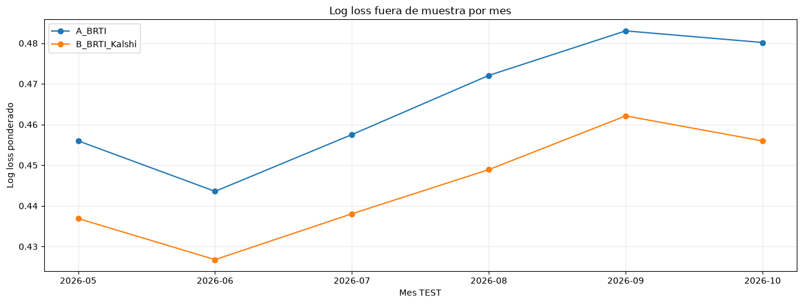
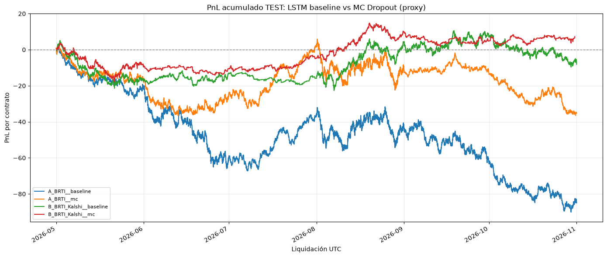

# Avances del TP: estimación de probabilidades en contratos BTC15m de Kalshi

**Machine Learning II · Versión preliminar para revisión · 18 de noviembre de 2026**

## 1. Tema y objetivo del trabajo

El trabajo estudia si podemos mejorar la estimación de la probabilidad de liquidación **YES** de los contratos de Bitcoin de 15 minutos de Kalshi y utilizar esas probabilidades para evaluar decisiones de compra. Nos interesa distinguir entre predecir correctamente un resultado y encontrar una operación conveniente al precio disponible.

La propuesta inicial combina información del mercado de Kalshi, el índice de referencia BRTI y Polymarket como fuente adicional. En esta etapa avanzamos en la preparación de la base y la evaluación de **XGBoost y LSTM con BRTI y Kalshi**. La incorporación de Polymarket a los modelos continúa pendiente.

## 2. Obtención y depuración inicial de los datos

Reunimos contratos y precios históricos de Kalshi, junto con observaciones del índice BRTI, para el período solicitado de diciembre de 2025 a octubre de 2026. Revisamos duplicados, escalas de precios y cobertura temporal, registrando los faltantes antes de construir la base de trabajo.

## 3. Transformaciones y estructura de la base de trabajo

Organizamos los datos en una tabla donde **cada fila representa un contrato en un momento de decisión, al cierre de una vela de un minuto**. Un mismo contrato aporta varias observaciones a lo largo de su vida, todas asociadas con su resultado final YES/NO.

La base completa reúne **423.135 observaciones correspondientes a 30.272 contratos**. De ellas, **395.105 observaciones** cumplen los controles principales para entrenamiento; los modelos aplican además filtros comunes de disponibilidad y validez de precios.

### Información de cada observación

| Grupo | Información que contiene |
|---|---|
| Identificación y tiempo | Contrato, inicio, cierre, instante de decisión y minutos restantes. |
| Referencia del contrato | Strike o nivel de referencia contra el cual se interpreta la situación del índice. |
| Comportamiento de BRTI | Distancia porcentual al strike, retorno reciente y volatilidad suavizada. |
| Mercado de Kalshi | Precio YES de referencia, precios bid/ask y spread. |
| Resultado y calidad | Liquidación YES/NO y marcas de disponibilidad de las variables. |

Las transformaciones principales fueron:

- **Unificar las escalas y los tiempos:** los precios de los contratos se expresan en dólares entre 0 y 1, y los horarios se trabajan en UTC.
- **Construir variables interpretables:** distancia al strike, retorno de un minuto y volatilidad EWMA, que da mayor peso a los movimientos recientes.
- **Alinear las fuentes:** para cada decisión usamos una media BRTI de 60 segundos que termina dos segundos antes del instante considerado, y asignamos retornos y volatilidad desde registros anteriores disponibles.
- **Controlar continuidad y faltantes:** las ventanas BRTI utilizadas deben ser consecutivas; los huecos se registran y no se interpolan. Las filas que incumplen los controles requeridos quedan fuera del entrenamiento.
- **Separar información y respuesta:** la liquidación final se conserva como etiqueta, sin introducirla entre los predictores.

El precio YES de referencia utiliza el cierre de operaciones de la vela y, cuando falta, el punto medio entre sus referencias bid/ask. Para entrenar se exige disponer del strike informado por la API. La base se guarda en formatos CSV y Parquet, acompañada de reportes de calidad, para reutilizar el mismo procesamiento en ambos modelos.

La auditoría detectó **10.559 segundos BRTI ausentes y 620 discontinuidades** dentro del período solicitado. Estos controles permiten identificar las observaciones utilizables, aunque los timestamps históricos no certifican por sí solos la latencia real de publicación de cada dato.

## 4. XGBoost: probabilidades y evaluación de una regla de compra

### Qué evaluamos

Entrenamos modelos de árboles para estimar la probabilidad de YES a partir de dos conjuntos de variables:

- **A — BRTI:** minutos restantes, distancia al strike, retorno reciente y volatilidad.
- **B — BRTI + Kalshi:** las mismas variables, agregando el precio YES de referencia y el spread.

Ambos utilizan la misma base de decisiones válidas para facilitar la comparación. Las observaciones se ponderan para que los contratos con más filas no tengan mayor influencia solo por ese motivo.

La evaluación es **walk-forward mensual, con test de mayo a octubre de 2026**. El entrenamiento se amplía con el paso de los meses, se utiliza el mes previo al test como validación y se mantiene cada contrato completo dentro de un único bloque. También se aplica una separación de 15 minutos alrededor de las fronteras temporales. Por ejemplo, el primer fold aprende con diciembre–marzo, valida con abril y evalúa en mayo.

Los parámetros del modelo, el umbral de entrada y la ventana de minutos permitidos se eligen con validación. Después se aplican al mes de test sin reajustarlos con sus resultados.

### Resultados predictivos

Agregar la información de Kalshi **reduce la log loss ponderada en los seis meses evaluados**. Esta métrica mide el error de las probabilidades estimadas; valores menores indican mejor desempeño.

*Figura 1. Salida original del notebook XGBoost. B —BRTI + Kalshi— mantiene menor error que A en todos los meses de test. La ponderación equilibra la contribución de los contratos.*

### Resultados de compras simuladas

Evaluamos una regla que compara la probabilidad estimada con el precio ask de referencia y compra cuando la diferencia supera el umbral seleccionado. Se permite **una compra YES por contrato, mantenida hasta liquidación**, sin salida anticipada.

| Variables | Operaciones simuladas | PnL acumulado, USD | Operaciones con PnL positivo |
|---|---:|---:|---:|
| A — BRTI | 8.806 | −29,180 | 45,98 % |
| B — BRTI + Kalshi | 5.620 | −32,772 | 61,67 % |

El PnL es la suma del resultado de comprar **una unidad por operación**; no es un porcentaje de retorno sobre una cuenta. Los costos están configurados en cero.

**La mejora predictiva no se tradujo en ganancia acumulada con esta regla.** B obtiene mejores probabilidades y una mayor proporción de operaciones positivas, pero su resultado económico total es negativo. Esto muestra la importancia de considerar el precio de entrada y la selección de operaciones, además de la calidad de la clasificación.

## 5. LSTM: secuencias recientes y filtro MC Dropout

### Qué evaluamos

La LSTM utiliza los mismos grupos de variables y la misma evaluación temporal, pero recibe **hasta diez observaciones consecutivas del mismo contrato**, terminando en el instante de decisión. Buscamos comprobar si la evolución reciente aporta información adicional frente a una observación aislada.

Las variables se estandarizan utilizando únicamente el entrenamiento. Las secuencias no atraviesan contratos ni huecos temporales y, cuando hay menos historia disponible, se utiliza una secuencia más corta. La configuración y el momento de detener el entrenamiento se eligen con validación.

Comparamos dos reglas de entrada sobre cada red entrenada:

- **Predicción normal:** decidir usando la probabilidad habitual del modelo.
- **MC Dropout:** repetir cien veces la predicción con distintas máscaras internas de dropout y utilizar un percentil inferior como puntuación conservadora para decidir la compra.

Este filtro describe dispersión de las predicciones bajo dropout; sus intervalos no se interpretan como coberturas estadísticas calibradas. Las reglas económicas de ambas variantes se seleccionan por separado con validación, por lo que la comparación combina el filtro con los parámetros de entrada elegidos.

### Resultados de la corrida principal

La corrida principal usa semilla 42. Todas las cifras siguientes corresponden al test acumulado de mayo–octubre y a una unidad por compra.

En la evaluación predictiva, B obtiene menor log loss ponderada que A en los seis meses, con valores mensuales entre **0,4283 y 0,4640**. Frente al XGBoost con las mismas variables, la LSTM no muestra una mejora general del error probabilístico; el interés de la comparación económica está en cómo se seleccionan las entradas.

| Variables | Regla de entrada | Operaciones | PnL acumulado, USD | Mayor caída acumulada, USD |
|---|---|---:|---:|---:|
| A — BRTI | Normal | 11.679 | −84,984 | 92,128 |
| A — BRTI | MC Dropout | 7.886 | −35,200 | 42,293 |
| B — BRTI + Kalshi | Normal | 5.395 | −8,115 | 27,771 |
| B — BRTI + Kalshi | MC Dropout | 2.410 | +7,300 | 21,355 |

La mayor caída acumulada mide el descenso máximo desde un pico de la curva de PnL, incluyendo el punto inicial cero; se muestra como magnitud positiva en dólares, no como porcentaje.

*Figura 2. Salida original de la corrida principal. La combinación B + MC termina con PnL positivo, aunque presenta períodos de pérdidas y caídas intermedias. Las curvas acumulan una unidad por operación, con distinta cantidad de operaciones según la variante.*

En esta corrida, agregar Kalshi mejora el resultado económico frente a usar solo BRTI. La variante B + MC reduce la cantidad de compras y termina en positivo. Su ganancia media es aproximadamente **USD 0,003 por operación**, por lo que incorporar costos reales es relevante para evaluar si ese margen se conserva.

### Sensibilidad al entrenamiento

Repetimos el mismo procedimiento con otras dos semillas. Para B —BRTI + Kalshi— obtuvimos:

| Semilla | PnL normal, USD | PnL con MC Dropout, USD |
|---|---:|---:|
| 42 | −8,115 | +7,300 |
| 4223 | +39,939 | +25,914 |
| 1234 | +8,304 | +10,816 |

B + MC termina con PnL positivo en las tres corridas guardadas, pero **el efecto del filtro no es uniforme**: con semilla 4223 reduce el PnL total respecto de la entrada normal. La cantidad de operaciones también cambia, y los modelos que usan solo BRTI terminan en negativo en las tres corridas, con ambas reglas.

Estos resultados justifican seguir estudiando la combinación de información del mercado y selección de entradas, pero todavía no permiten afirmar una rentabilidad estable ni una superioridad general de LSTM sobre XGBoost.

### Alcance de los avances

Ya contamos con una base estructurada y controles temporales, dos familias de modelos evaluadas mes a mes y una comparación inicial de reglas de entrada. También se entrenaron modelos finales con información hasta octubre, destinados a una evaluación posterior; no se presentan aquí resultados de noviembre.

Las cifras económicas siguen siendo **simulaciones con precios de velas, costos cero y sin verificación de liquidez o ejecución efectiva**. Las estrategias actuales mantienen hasta liquidación. Entre las evaluaciones pendientes están incorporar costos, estudiar salidas anticipadas y medir el aporte incremental de Polymarket, además de comparar explícitamente contra el precio de Kalshi como probabilidad de referencia fuera de muestra.

---

*Fuente de las cifras y figuras: salidas guardadas de los [notebooks 02](../../02_BTC15m_walkforward_corregido.ipynb), [03](../../03_BTC15m_XGBoost_walkforward_final_octubre.ipynb), [04 principal](../../04_BTC15m_LSTM_walkforward_MC_Dropout_final_octubre.ipynb), [04 Copy1](../../04_BTC15m_LSTM_walkforward_MC_Dropout_final_octubre-Copy1.ipynb) y [04 Copy2](../../04_BTC15m_LSTM_walkforward_MC_Dropout_final_octubre-Copy2.ipynb). Este borrador organiza los resultados existentes; no corresponde a una nueva ejecución ni a una reproducción independiente de los experimentos.*
