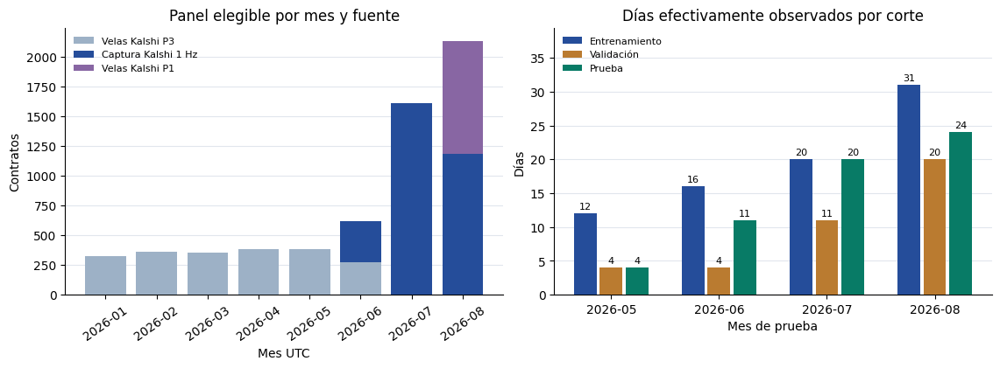
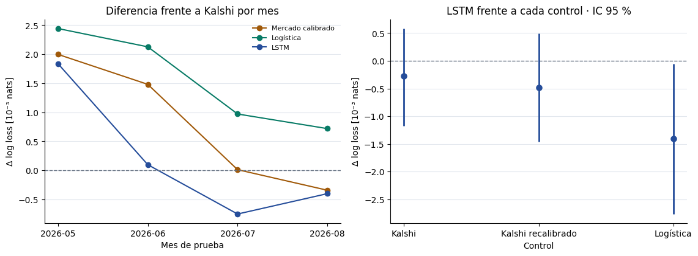

# LSTM para estimar la resolución de Kalshi BTC15M

**Aprendizaje Automático II**

## Resumen

Evaluamos si una LSTM mejora la probabilidad que refleja el precio de Kalshi cinco minutos antes del vencimiento. Usamos cuatro pruebas mensuales consecutivas con entrenamiento expansivo. En **4.745 contratos y 59 días observados**, el log loss pasa de **0,368322** para Kalshi a **0,368049** para la LSTM, con un IC 95 % de la diferencia que incluye cero. El contraste con la regresión logística favorece ligeramente a la LSTM. [Notebook ejecutado](estudio_btc15m.ipynb)

## Datos y diseño

El universo elegible contiene **6.174 contratos de enero a agosto de 2026**. Una fila representa un vencimiento KXBTC15M y una decisión a T−5. La etiqueta es la liquidación oficial YES o NO. Se exigen dos puntas válidas, spread de hasta 5¢ y continuidad de las velas de Binance. El horizonte fijo evita contar varias decisiones por contrato.

El corte de información externa es el menor entre el reloj atribuido a la cotización de Kalshi y un segundo antes de decidir. Una vela de Binance queda disponible al cerrar más un segundo. En validación y prueba se retiran las secuencias que cruzan el inicio de su etapa. Las etiquetas usadas para ajustar deben estar liquidadas al fin de entrenamiento o validación.

El panel combina una muestra dispersa de velas históricas, capturas a 1 Hz y velas del tramo final. La cobertura mensual y los días observados se muestran explícitamente. Los estratos por fuente también reflejan diferencias de calendario. [Insumos y procedencia](data/README.md)

| Mes de prueba | Contratos de entrenamiento | Días de entrenamiento | Contratos de validación | Contratos de prueba | Días de prueba |
|---|---:|---:|---:|---:|---:|
| Mayo | 1.040 | 12 | 383 | 383 | 4 |
| Junio | 1.423 | 16 | 383 | 622 | 11 |
| Julio | 1.806 | 20 | 622 | 1.606 | 20 |
| Agosto | 2.428 | 31 | 1.606 | 2.134 | 24 |

## Modelo y resultados

Una LSTM many-to-one resume 30 pasos de un minuto, con retorno, rango, logaritmo del volumen y fracción compradora. Su estado final se combina con tres variables de contexto y corrige el logit de mercado. Los controles son el punto medio, el punto medio recalibrado y una logística con las mismas entradas aplanadas. La normalización usa entrenamiento. La penalización de la logística y la época de la LSTM se eligen durante la validación anterior al mes de prueba.

| Modelo | Log loss | Brier | AUC |
|---|---:|---:|---:|
| Kalshi | 0,368322 | 0,116093 | 0,916212 |
| Kalshi recalibrado | 0,368528 | 0,116208 | 0,916153 |
| Regresión logística | 0,369450 | 0,116711 | 0,915568 |
| LSTM | 0,368049 | 0,116199 | 0,916225 |

El Δ de log loss de la LSTM frente al mercado es **−0,000273 nats** con IC 95 % **[−0,001170 a +0,000583]**. Frente a la logística es **−0,001402** con IC **[−0,002765 a −0,000059]**. Los intervalos remuestrean días, condicionados a los modelos ajustados. Para la LSTM, el Δ frente al mercado es positivo en el tramo etiquetado como velas P3 y negativo en las otras dos fuentes de la muestra. El promedio agregado oculta parte de esa variación.

## BRTI y simulación

BRTI es el índice con el que liquida el contrato. En un análisis focal de **1.182 contratos** con cobertura, agregamos la distancia entre la media de BRTI de los 60 segundos previos al corte y el umbral conocido. Ambas LSTM se ajustan y evalúan sobre las mismas filas. El Δ de agregar BRTI es **+0,000002 nats**, con IC 95 % **[−0,000169 a +0,000236]**.

Simulamos una compra de una unidad al lado con mayor excedente después de un escenario de comisión. El umbral fijo es 2¢. Al agregar 1¢ de fricción se mantienen las señales originales. La LSTM genera **72 compras**, **−3,32 USD netos** a la punta observada y **−4,04 USD** con la fricción adicional. Para los tramos de velas, la punta es una referencia histórica. Las cifras están condicionadas al supuesto de ejecución de una unidad.

## Conclusión

La extensión temporal permite contrastar la mejora en fechas y fuentes distintas. En esta muestra, la LSTM obtiene una mejora pequeña frente al control lineal. La evidencia frente a Kalshi es incierta, y la simulación con costes termina en negativo. El código, las decisiones de alineación y los resultados por corte están en el [notebook](estudio_btc15m.ipynb).
